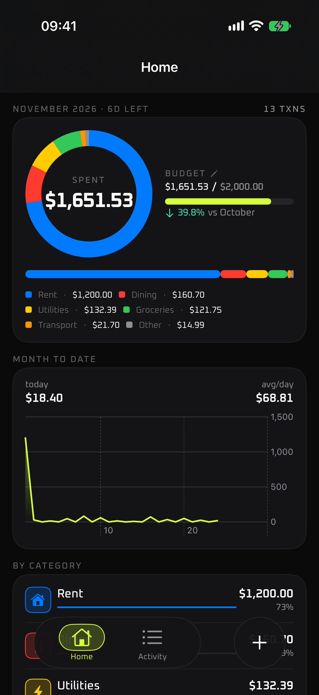
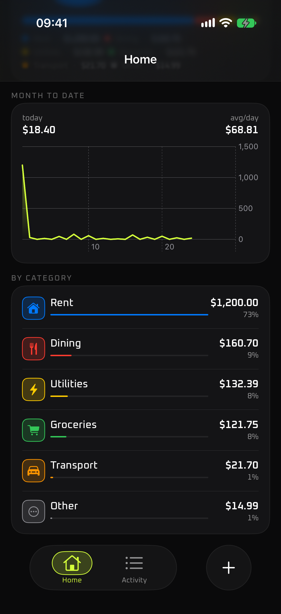
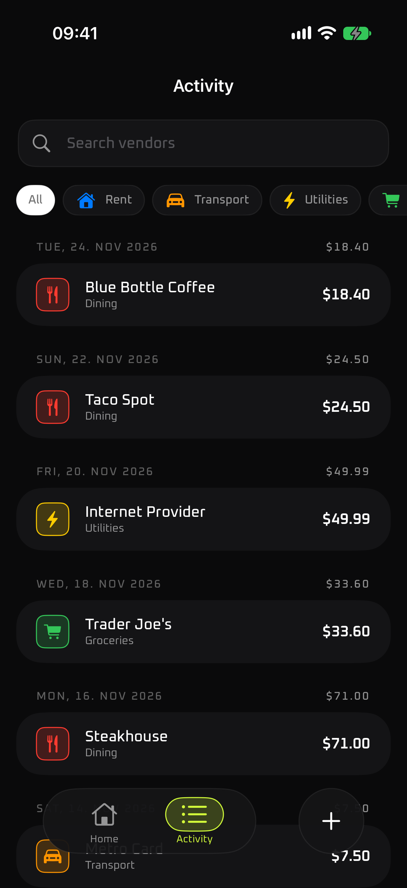
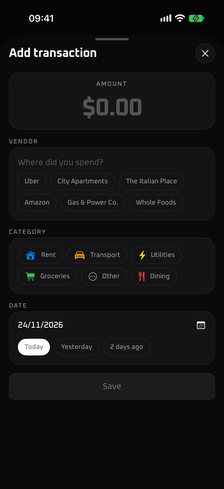
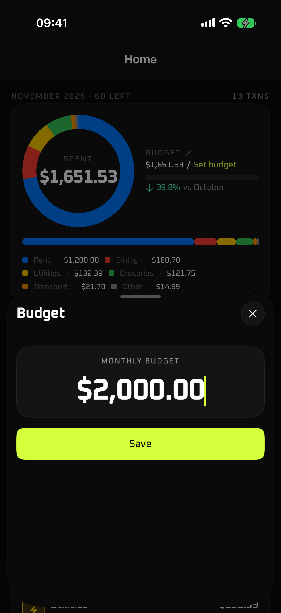
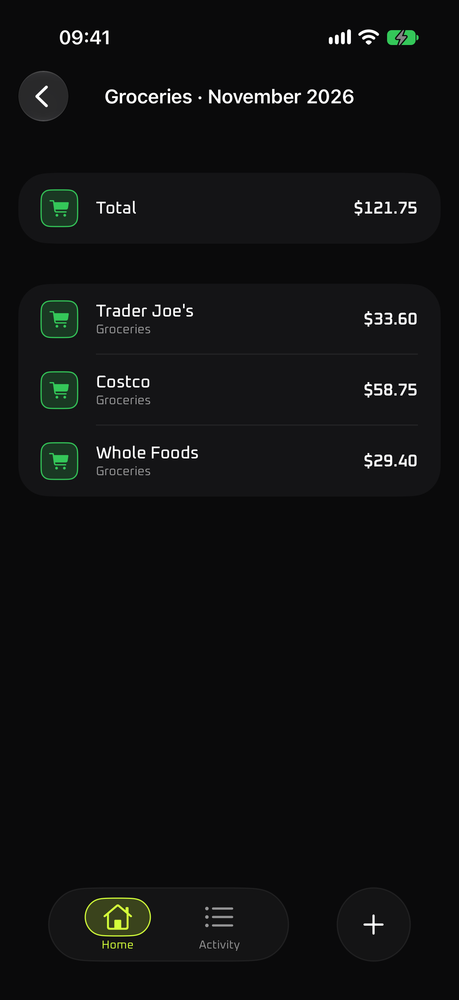

# BudgetTracker

A personal spending tracker for iOS, built with **SwiftUI**, **SwiftData** and **Swift 6 strict concurrency**. It has a custom dark-first design system, a reactive data layer built on actors and `AsyncStream`, and tests at every layer.

<p align="center">
  
  
  
</p>
<p align="center">
  
  
  
</p>

## Features

- **Monthly dashboard**: page through months to see total spend against your budget, a category donut, a month-to-date chart and a comparison with the previous month.
- **Monthly budget**: set a single app-wide budget and track progress toward it.
- **Spending by category**: ranked breakdown; tap a category to see its transactions for that month.
- **Activity feed**: every transaction grouped by day, with vendor search and category filters.
- **Quick add**: amount, vendor (suggested from past vendors), category, and date with Today / Yesterday shortcuts.
- **Custom design system**: semantic color tokens with light and dark variants, the Oxanium typeface and reusable components.

## Technical highlights

- **MVVM with protocol-based dependency injection**: ViewModels depend on `TransactionsProviderProtocol`, `CategoriesProviderProtocol` and `AppSettingsProtocol`. `AppDependencies` switches the whole app between SwiftData and in-memory implementations with no singletons and no `@Environment` DI.
- **Reactive, actor-isolated data layer**: providers are actors that stream `DataState<T>` (loading / data / error) over `AsyncStream`. Every write re-emits to all live observers through a shared `DataStreamRegistry`, so screens stay in sync without manual refreshes. Stale fetches are superseded per stream.
- **Swift 6 language mode** with strict concurrency checking. ViewModels cancel their observer tasks in an `isolated deinit`.
- **Router-driven navigation**: `AppRouter` owns the selected tab, a `NavigationPath` per tab and the presented sheet. Routes are a typed `AppRoute` enum resolved in one place.
- **Observable settings**: `@Observable` settings mirror `UserDefaults` into stored properties, so views re-render when the budget changes.
- **Two-layer theming**: a raw palette maps to semantic tokens (`Color.bgCanvas`, `Color.textPrimary`, …), and typography tokens are applied with `.textStyle(_:)`. Loading states use `.redacted` with a shimmer.

## Architecture

```
View (SwiftUI)  →  ViewModel  →  TransactionsProviderProtocol / CategoriesProviderProtocol / AppSettingsProtocol
                                        ↓                                  ↓
                               SwiftData providers + AppSettings    In-memory providers + InMemoryAppSettings
                               (production)                         (development, previews, tests)
```

See [`docs/ARCHITECTURE.md`](docs/ARCHITECTURE.md) for the layers and the reasoning behind key decisions, and [`docs/THEMING.md`](docs/THEMING.md) for the design system.

## Testing

- **ViewModel unit tests** use [Swift Testing](https://developer.apple.com/documentation/testing) with mock providers.
- **Provider contract tests** run one shared suite against both the SwiftData and in-memory providers, so the two implementations can't drift apart.
- **Snapshot tests** use [swift-snapshot-testing](https://github.com/pointfreeco/swift-snapshot-testing) to cover reusable components and screen sections in light and dark mode.

```bash
xcodebuild -project BudgetTracker.xcodeproj -scheme BudgetTracker \
  -destination 'platform=iOS Simulator,name=iPhone 17' test
```

## Running the app

Requirements: Xcode 26, iOS 26.2+.

Open `BudgetTracker.xcodeproj` and run the **BudgetTracker** scheme. During development the app runs on in-memory providers seeded with about six months of sample transactions. To use persistent SwiftData storage, switch to `.swiftData()` in `BudgetTrackerApp.swift`.

### Regenerating screenshots

The screenshots above come from a UI test (`ReadmeScreenshotTests`) that drives the app in dark mode with a clean status bar:

```bash
./scripts/capture-screenshots.sh
```

## Roadmap

- [ ] Finish the Month Category Spending screen (currently a placeholder)
- [ ] Edit and delete transactions
- [ ] Insights tab
- [ ] Import tab (e.g. CSV / bank statements)
- [ ] Switch the default storage to SwiftData
- [ ] Complete localization
